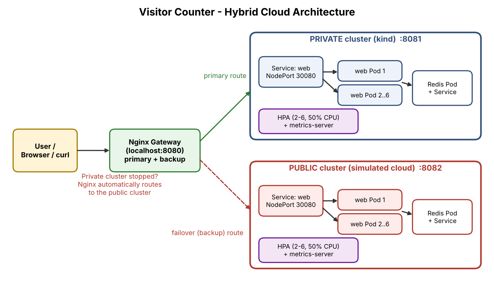

# Visitor Counter on Kubernetes (Flask + Redis)

Containerised Flask app backed by Redis, deployed on Kubernetes with self-healing, autoscaling (HPA),
a simulated hybrid-cloud failover and a cost-optimisation analysis.



## Layout
| Path | Purpose |
|---|---|
| `app/` | Flask source + requirements |
| `Dockerfile` / `Dockerfile.before` | optimised multi-stage image / naive image (for comparison) |
| `docker-compose.yml` | run locally (Task 1) |
| `k8s/` | Deployments, Services, HPA (Tasks 2-3); `k8s/before/` = over-provisioned baseline |
| `kind/`, `hybrid/`, `scripts/` | two-cluster hybrid demo + Nginx failover gateway (Task 4) |
| `tools/` | load generator, cost calculator (Tasks 3, 5) |

## Quick start
```bash
docker compose up --build            # http://localhost:5000
kind create cluster --name private --config kind/private.yaml
kind load docker-image visitor-counter:v1 --name private
kubectl apply -f k8s/
curl http://localhost:8081/info
```
Full step-by-step instructions are in the PDF guide.

## Endpoints
`/` counter - `/info` JSON (cluster+pod) - `/health` liveness - `/ready` readiness (checks Redis) - `/work` CPU burner for HPA tests
